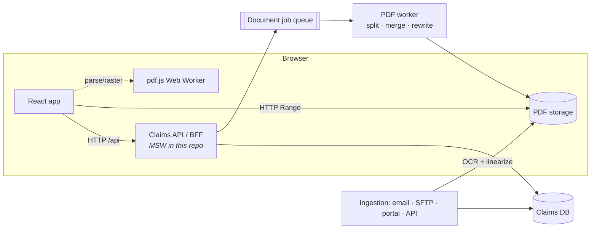
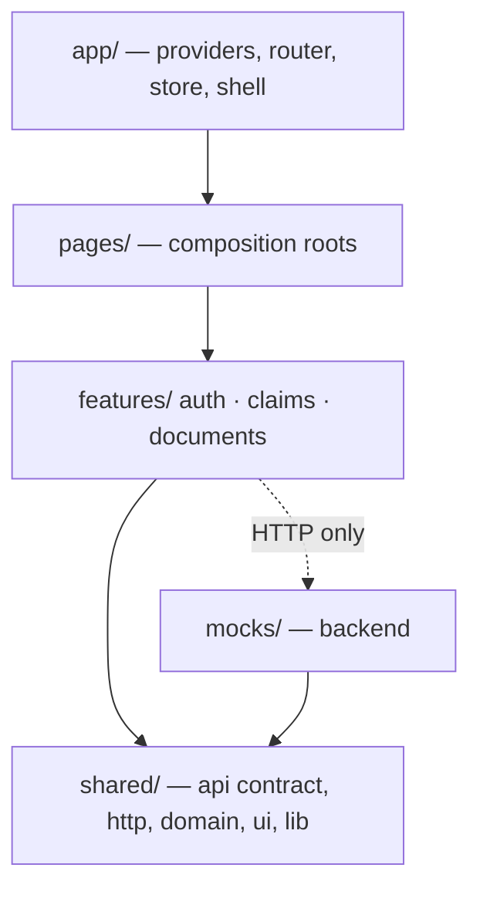
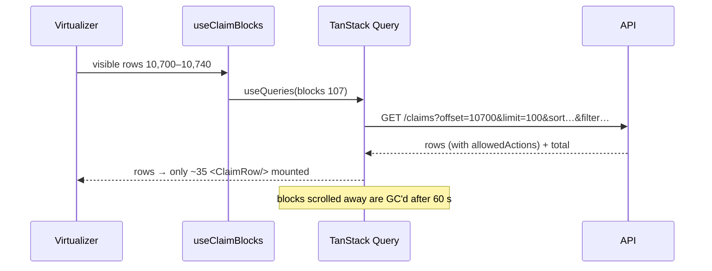
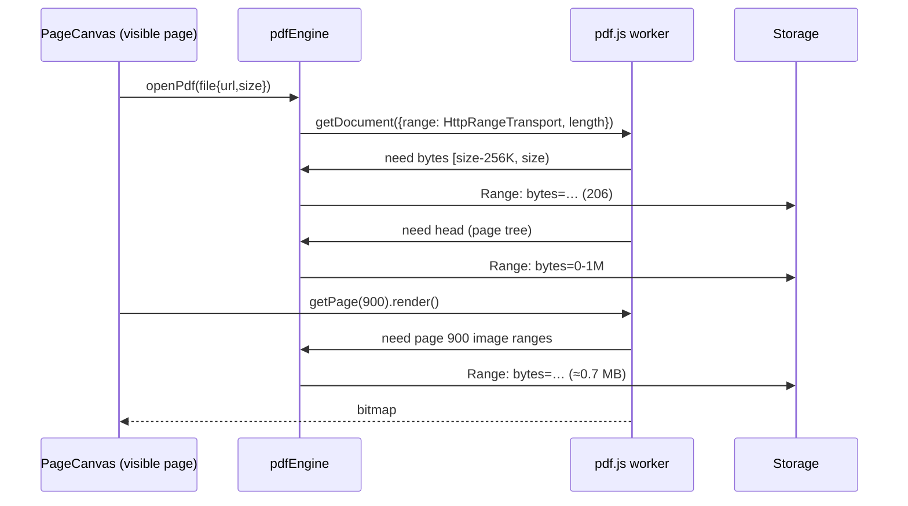
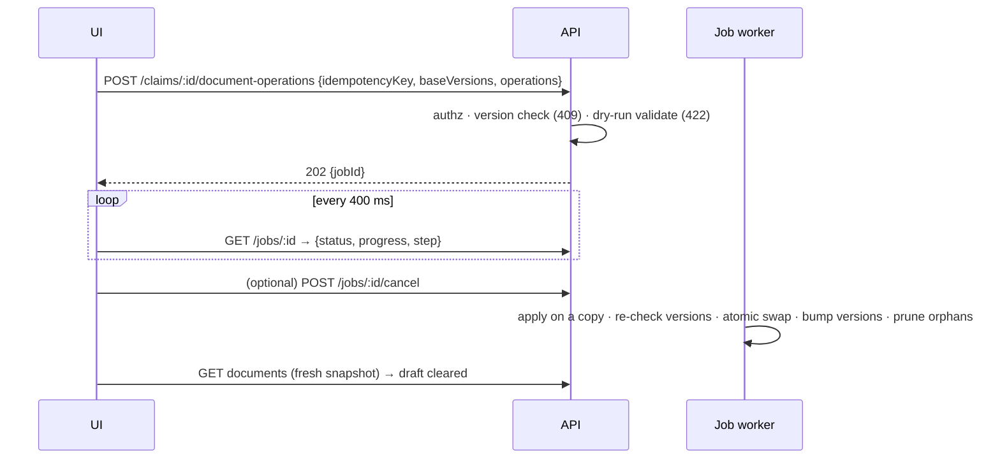

# Architecture

This document covers component boundaries, state, data flow, the backend contract, and where enforcement lives. Trade-offs are recorded as ADRs in [`docs/adr`](adr).

## 1. System context

The browser never downloads a full document. It talks to the API for metadata and commands, and fetches **byte ranges** of immutable source files from storage (S3/Blob behind a CDN in production; Vite's static server here).

## 2. Layers and boundaries

- **Pages compose features.** `ClaimsPage` wires grid hover-intent to the documents feature's prefetch. The features don't know about each other.
- **Feature public APIs** are `index.ts` files. The documents feature has two entry points: a light `index.ts` (queries, prefetch, reducer) and `workspace.ts`. The second contains pdf.js and is imported only by the lazy route.
- **ESLint enforces** that `shared/` can't import features and features can't import `mocks/`.

## 3. State management

| State                           | Owner                                   | Reasoning                                                                                                     |
| ------------------------------- | --------------------------------------- | ------------------------------------------------------------------------------------------------------------- |
| Server data                     | TanStack Query                          | Caching, request dedupe, abort on unmount, prefetch, `gcTime` eviction, optimistic updates with rollback      |
| Grid view state                 | URL                                     | Shareable, survives refresh, Back restores it, no sync code                                                   |
| Document draft and workspace UI | Redux Toolkit                           | Client-owned, read by many distant components, updated at high frequency; memoized selectors limit re-renders |
| Session                         | Context                                 | Read everywhere, written on sign-in/out only                                                                  |
| pdf download stats              | external store + `useSyncExternalStore` | Lives outside React (in the pdf engine)                                                                       |

**The editing model.** The workspace keeps `base` (the last server snapshot) plus `past: DocumentOperation[]`, a command log. The visible document is the memoized projection `applyOperations(base, past)`.

- Undo/redo moves commands between stacks.
- The same log is persisted to localStorage (draft recovery) and is the commit payload.

## 4. Data flows

### 4.1 Grid (server-side row model)

The server caches the filtered and sorted id list per (user, query), so scrolling through 250 blocks costs one sort, not 250.

### 4.2 Grid → workspace

1. **Hover intent (120 ms) or focus** prefetches the workspace JS chunk, `GET /claims/:id/documents`, and the first page's byte ranges.
2. **Click** navigates with a View Transition. The header renders immediately from the grid row passed in router state; skeletons cover the rest.
3. **Back** restores the grid from the URL and the Query cache. No refetch flash.

### 4.3 Large document loading

- `disableAutoFetch` means nothing is fetched in the background. The LRU keeps at most 4 open documents and destroys evicted ones in the worker.
- Pages render only after the user has stayed on them for 60 ms, and are cancelled or released on unmount.

### 4.4 Committing edits (long-running, atomic)

## 5. Backend API assumptions

| Endpoint                                                            | Notes                                                                                                           |
| ------------------------------------------------------------------- | --------------------------------------------------------------------------------------------------------------- |
| `POST /auth/login`, `GET /auth/me`                                  | Returns `{token, user, permissions[]}`                                                                          |
| `GET /claims?offset&limit&sortBy&sortDir&q&status&priority&channel` | `limit` capped at 500; rows carry `version` and `allowedActions`                                                |
| `GET /claims/stats`                                                 | Respects the caller's data scope                                                                                |
| `PATCH /claims/:id {version, changes}`                              | 409 on stale version, 422 on validation                                                                         |
| `POST /claims/:id/assign {version, assigneeId}`                     | Assignee must be an adjuster in the claim's region                                                              |
| `DELETE /claims/:id`                                                | Admin only                                                                                                      |
| `GET /claims/:id/documents`                                         | `{claim, documents[{id, version, pages: PageRef[]}], files{id → url, size, pageCount, pageSize}, capabilities}` |
| `POST /claims/:id/document-operations`                              | 202 + job; idempotent per key                                                                                   |
| `GET /jobs/:id`, `POST /jobs/:id/cancel`                            | Cooperative cancellation                                                                                        |
| `GET/POST/DELETE /claims/:id/comments`, `/annotations`              | Keyed by stable `pageId`                                                                                        |
| Static file URLs                                                    | Must support `Range` (206) and must not be served with `Content-Encoding`                                       |

## 6. Where enforcement lives

| Concern        | Server (authoritative)                                                                                     | Client (UX)                                                               |
| -------------- | ---------------------------------------------------------------------------------------------------------- | ------------------------------------------------------------------------- |
| Authentication | Bearer token on every request; 401 → sign-out                                                              | Route guard                                                               |
| Authorization  | Role permissions, region scoping, ownership, closed-claim lock (`policy.ts`), re-checked on every endpoint | Hide/disable buttons from `permissions`, `allowedActions`, `capabilities` |
| Data scoping   | Out-of-scope records return **404** (no existence leak)                                                    | —                                                                         |
| Validation     | zod schemas, document-op dry-run                                                                           | Same rules for instant feedback; URL params parsed defensively            |
| Consistency    | Versions (409), idempotency keys, atomic commit, orphan pruning                                            | Conflict dialog, draft kept on failure                                    |

## 7. Error handling and resilience

- **Per-region error boundaries:** shell, viewer, thumbnails and comments each recover independently.
- **Query retries:** only transient failures (network/5xx) are retried, with exponential backoff; 4xx are never retried.
- **pdf transport:** a non-206 response or network error surfaces as a page-level error with Retry, and the document is evicted for a clean reopen.
- **Unsaved changes:** draft persisted, `beforeunload` guard, and a restore banner. A draft built on stale versions is discarded, with a notice.

## 8. Security notes

- No `dangerouslySetInnerHTML`; comment text renders as text. pdf.js runs with XFA disabled.
- Untrusted URL params are whitelisted before reaching the API. The server caps `limit`.
- Production additions: httpOnly cookie sessions (OIDC), CSP, signed short-lived document URLs (SAS/presigned), and audit logging of document operations.
